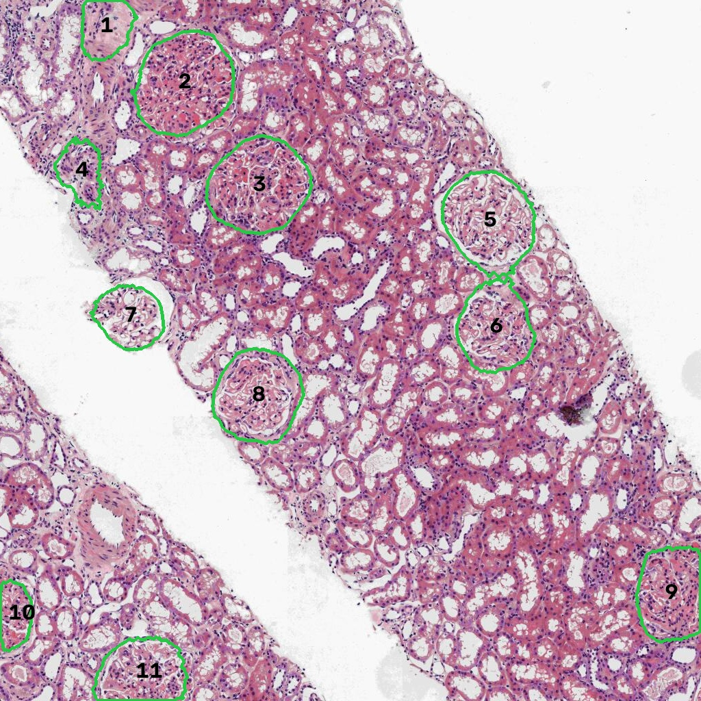
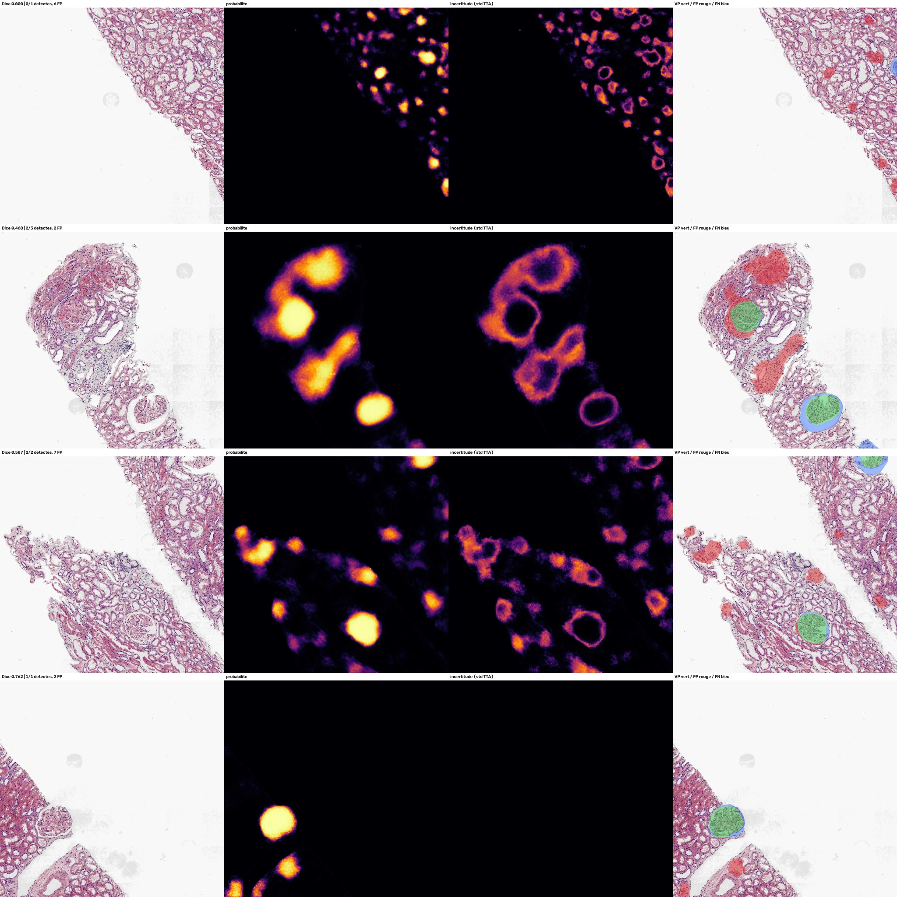

# Glomeruli Finder : segmentation de glomérules rénaux, entraînée de zéro, sur CPU

> Détecter, délimiter et compter automatiquement les glomérules sur des lames de rein, avec un réseau de
> 2 M de paramètres **entraîné sans aucun pré-entraînement**, sur 42 images d'une seule lame de rongeur,
> puis évalué sur du **rein humain pathologique jamais vu** (autre espèce, autre scanner).

<!-- Remplacer par le lien du Space une fois déployé -->
**[▶ Démo en ligne](https://huggingface.co/spaces/<compte>/glomeruli-finder)** · API REST · Docker · ONNX



## Résultats

<!-- ⟨à remplir⟩ : lancer `make train-all evaluate compare`, puis recopier reports/comparison.md -->

| Modèle | Dice (protocole honnête) | IC 95 % | F1 par glomérule | Latence CPU / image |
|---|---|---|---|---|
| U-Net résiduel **de zéro** (3 seeds) | ⟨à remplir⟩ | ⟨…⟩ | ⟨…⟩ | ⟨…⟩ |
| U-Net ResNet34 pré-entraîné ImageNet | ⟨…⟩ | ⟨…⟩ | ⟨…⟩ | ⟨…⟩ |
| *Notebook du challenge (réglé sur le jeu de test)* | *0,781* | — | — | — |

Ablations (contribution de chaque famille d'augmentations) : voir `reports/comparison.md`.

**Comment lire ces chiffres :**
- **Dice honnête** : le seuil, le mode de prédiction et le post-traitement sont choisis par *cross-fitting*.
  Chaque image de test est prédite avec des réglages choisis **sans elle**. Le 0,781 du notebook d'origine
  était réglé et mesuré sur les mêmes 11 images, il est donc optimiste. L'écart entre les deux est rapporté
  explicitement dans chaque `report.md`.
- **IC 95 %** : bootstrap sur les images. Avec 11 images de validation, l'incertitude est large, et c'est
  une information à part entière.
- **F1 par glomérule** : un glomérule compte comme trouvé si IoU ≥ 0,5. Le Dice seul ne dit pas combien de
  glomérules sont ratés ou fusionnés.

## Le problème

Un glomérule est l'unité de filtration du rein. Les pathologistes les comptent et les examinent sur
biopsie pour diagnostiquer les maladies rénales ou évaluer un greffon. C'est long, et la mesure varie
d'un observateur à l'autre.

Le défi : les données annotées sont rares, et chaque laboratoire a son espèce, sa coloration, son
scanner et son grossissement. Un modèle utile doit **généraliser à ce qu'il n'a jamais vu**.

| Contrainte du challenge | Réponse |
|---|---|
| Aucun réseau pré-entraîné | U-Net résiduel compact (2,07 M de paramètres), init. de He, biais de sortie calé sur la proportion de glomérules |
| 42 images, une seule lame de rongeur | Augmentation massive **à la volée** (≈ 20 000 crops tous différents) : déconvolution H&E + perturbation des colorants, zoom log-uniforme ×0,55–1,8, rotations, élastique, flou / bruit / JPEG |
| Test sur d'autres espèces, colorations, scanners | Validation sur rein humain (train_AKI), TTA 8 symétries, multi-échelle, **échelle automatique** |
| Pas de GPU | Résolution de travail ×0,375, crops 192 px, export ONNX |

## Ce qui rend l'évaluation crédible

1. **Pas de fuite vers le test.** Le modèle livré est celui de la dernière epoch (`checkpoint: last`) : le
   domaine de test ne sert jamais à choisir le modèle. Le script refuse de s'exécuter si une image
   d'évaluation a servi à l'entraînement.
2. **Cross-fitting par zone de lame** pour régler le seuil et le mode, plus le score optimiste à côté, pour
   montrer l'écart.
3. **Intervalles de confiance** (bootstrap) et **plusieurs seeds** d'entraînement.
4. **Métriques par instance** : précision, rappel, F1, erreur de comptage, et une typologie des erreurs
   (manqué / mal délimité / fusionné / fausse détection).
5. **Contrôle qualité des données** (`scripts/check_data.py`) : il détecte les masques posés sur le verre de
   la lame. Pendant le développement, il a repéré une inversion de deux tuiles qui faussait l'évaluation.

## Au-delà du score

- **Carte d'incertitude.** L'écart-type entre les passes de TTA indique où le modèle hésite. Chaque
  glomérule reçoit un score de confiance, et les cas douteux sont signalés en jaune pour vérification humaine.
- **Échelle automatique.** Les glomérules humains sont environ 1,35 fois plus gros que ceux du rongeur. Au
  lieu de régler le zoom à la main, le modèle mesure les objets qu'il détecte et ajuste l'échelle pour
  retrouver la taille vue à l'entraînement (mode `auto`).
- **Inférence par tuiles** avec fusion pondérée des chevauchements : elle traite des régions de lame de
  taille quelconque.
- **Quantification** : nombre de glomérules, surfaces (en µm² si les microns par pixel sont fournis),
  diamètres, confiance, export CSV.
- **Séparation des glomérules collés** (ligne de partage des eaux, optionnelle), pour un comptage juste.

## Analyse d'erreurs

Chaque évaluation produit `error_gallery.jpg` (image, probabilité, incertitude, erreurs), `per_image.csv`
et un `report.md`.



<!-- ⟨à remplir⟩ après l'évaluation complète : 3-4 phrases sur les causes d'échec observées
     (ex. glomérules sclérosés, structures en bord de tuile, faux positifs sur artères ou tubules). -->

## Utilisation

```bash
pip install torch --index-url https://download.pytorch.org/whl/cpu
pip install -e ".[api,onnx,demo,viz,dev]"
```

Données attendues (format du challenge, `<nom>.png` + `<nom>_mask.tif`) :

```
Set02_Glom_train_clean/
├── train03/     # entraînement
└── train_AKI/   # évaluation (domaine jamais vu)
```

| Commande | Effet |
|---|---|
| `python scripts/check_data.py --dir Set02_Glom_train_clean/train03` | contrôle qualité des paires image / masque |
| `make smoke` | vérification complète en quelques minutes |
| `make train-ref` | modèle de référence, 3 seeds (≈ 3 h par seed sur CPU) |
| `make train-all` | + modèle pré-entraîné et ablations |
| `make evaluate compare` | rapports, tableau comparatif, figures |
| `make export benchmark` | ONNX + latence par mode |
| `make api` / `make demo` / `make docker` | API REST, démo Gradio, conteneur |

Prédire un dossier (fichier de soumission RLE, tableau des glomérules, images annotées) :

```bash
python scripts/predict.py --checkpoint runs/unet_scratch_seed42/model_deploy.pth --input mes_images/ --mpp 0.5
```

API :

```bash
curl -F "file=@image.png" "localhost:8000/predict?overlay=true&mpp=0.5"
# -> {"summary": {"n_glomeruli": 10, ...}, "glomeruli": [{"area_um2": ..., "uncertain": false, ...}], ...}
```

Toute la configuration est en YAML (`configs/`), avec héritage (`_base_`) et surcharges en ligne
(`--set train.epochs=30`). Le suivi MLflow est optionnel (`train.mlflow: true`).

## Structure

```
src/glomseg/       package : données, augmentations, modèles, inférence, métriques, évaluation
scripts/           check_data, train, evaluate, compare, predict, export_onnx, benchmark, make_figures
configs/           référence, pré-entraîné, ablations, smoke test
app/               API FastAPI + démo Gradio
hf_space/          déploiement Hugging Face Spaces
tests/             25 tests (données synthétiques : métriques, inférence par tuiles, entraînement, API, ONNX)
notebooks/         notebook d'origine du challenge
```

## Vérification du pipeline sur données réelles

Avant les expériences complètes, toute la chaîne a été exécutée sur un sous-ensemble de 9 images H&E :
entraînement de 15 min sur CPU avec 5 images, évaluation par cross-fitting sur 4 images d'autres zones.
Le Dice honnête obtenu est de **0,45 (IC 95 % 0,15–0,69)**, contre 0,57 en réglant sur le test. **Ce n'est
pas un résultat** (trop peu de données et d'entraînement), mais une validation de bout en bout du
code : rapport dans [docs/pipeline_check_report.md](docs/pipeline_check_report.md). L'export ONNX
reproduit PyTorch à 1e-5 près et accélère le réseau d'un facteur 1,5 sur CPU (2 threads).

## Limites

- Outil de recherche, **pas un dispositif médical**.
- Évaluation sur peu d'images et peu de lames humaines : les intervalles de confiance sont larges.
  Une validation sur un jeu externe (HuBMAP, KPMP) serait la prochaine étape.
- Le mode `auto` suppose que le modèle détecte déjà correctement une partie des glomérules. Sur un domaine
  très éloigné, il peut se tromper d'échelle.

## Données et licence

Code sous licence MIT. Les images du challenge ne sont pas redistribuées : vérifier leurs conditions
d'utilisation avant de publier des exemples ou des poids entraînés.

Auteur : Serigne Touba MBAYE, M2 Data Science & Vision par ordinateur, Université de Bordeaux.
